# Wikipedia image box maker

Make an image and a caption look like a screenshot of a Wikipedia image box.

[Use it in your browser](https://vinevard.github.io/wikipedia-image-box-maker/).

| Wikipedia | Image box maker |
| :---: | :---: |
| 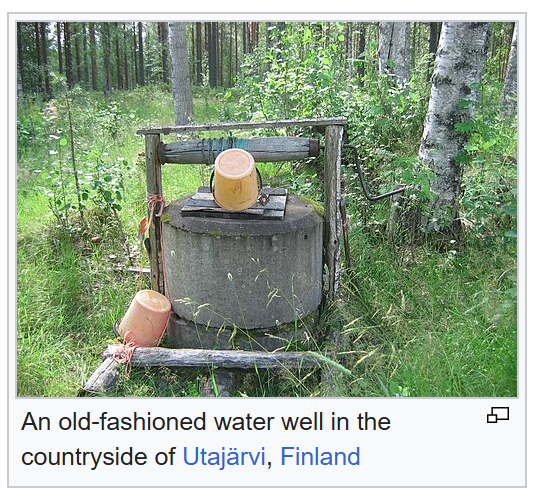 |  |

The left image is a screenshot of the [Well](https://en.wikipedia.org/wiki/Well) article, and the right image is
from this tool, with the same photo and caption.

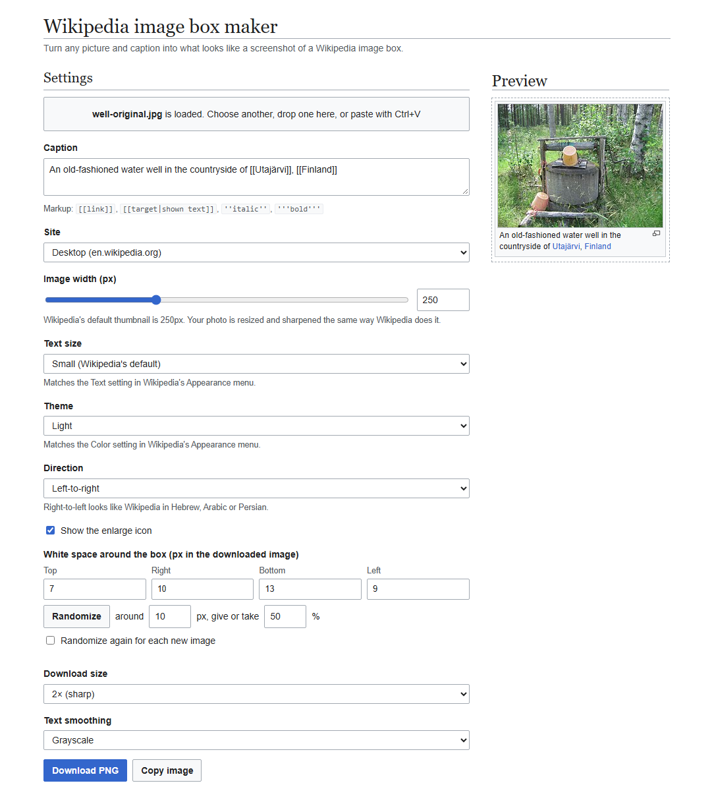

## Settings

| Setting | Options |
| --- | --- |
| Caption | Text with links, italic and bold. Refer to [Caption markup](#caption-markup). |
| Site | Desktop, or mobile at a phone width that you select |
| Image width | 50px to 600px. The Wikipedia default is 250px. |
| Text size | Small, Standard or Large, as in the Wikipedia Appearance menu |
| Theme | Light or Dark. The Dark theme makes the photo darker, as on Wikipedia. |
| Direction | Left-to-right, or right-to-left as in the Hebrew, Arabic and Persian Wikipedias |
| Enlarge icon | On or off |
| White space | Off, a value for each side, or random values. The default is 10px plus or minus 50%. The top usually gets less space than the bottom. |
| Download size | 1x, 2x or 3x. The result does not change with the pixel density of your screen. |
| Text smoothing | Grayscale, or sub-pixel as in Windows screenshots. The default is sub-pixel if your browser can make sub-pixel text. |

To load an image, choose a file, drop a file, or paste an image. You can also drag an image from a Wikipedia page.
Then the tool uses the original file from Wikimedia, not the smaller copy on the page. Most other sites do not let the
tool read their images, so save these images first.

Transparent areas of an image show white, as on Wikipedia.

The browser keeps the settings and the caption for your next visit, but it does not keep the image. To go back to
the default settings without a change to the caption, click "Reset settings".

### Caption markup

| Markup | Result |
| --- | --- |
| `[[Utajärvi]]` | A link with the text "Utajärvi" |
| `[[Point Danger Light\|Point Danger lighthouse]]` | A link with the text "Point Danger lighthouse" |
| `''italic''` | *italic* |
| `'''bold'''` | **bold** |

You can put markup in markup, for example `''[[Haymakers (painting)|Haymakers]]''`.

## Comparisons

In each pair, the left image is a 2x screenshot of a figure on Wikipedia and the right image is a 2x download from
this tool. The two images use the same original file, caption and settings. `tools/verify/compare.py` makes all of these
images.

<table>
<tr><th>Wikipedia</th><th>Image box maker</th></tr>
<tr><td>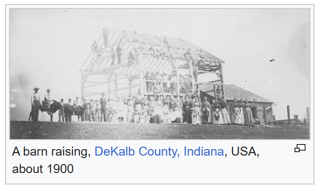</td><td></td></tr>
<tr><td colspan="2">A 300px figure. The original is smaller than the 2x thumbnail, thus the two images use the original.</td></tr>
<tr><td></td><td>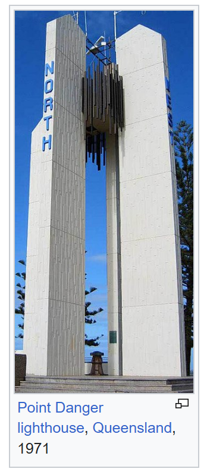</td></tr>
<tr><td colspan="2">A tall image at 150px</td></tr>
<tr><td>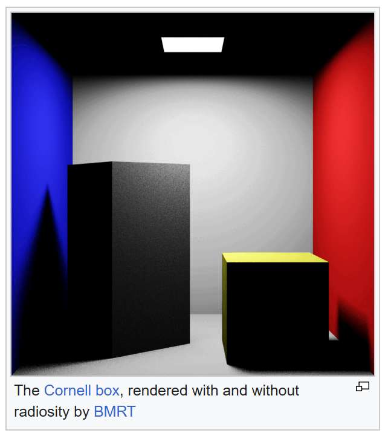</td><td>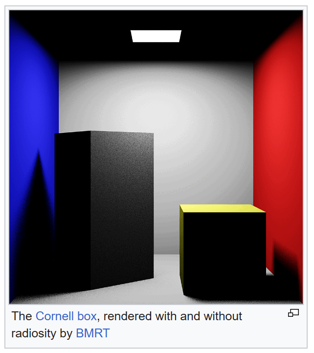</td></tr>
<tr><td colspan="2">A square image from an animated GIF. The tool uses the first frame.</td></tr>
<tr><td>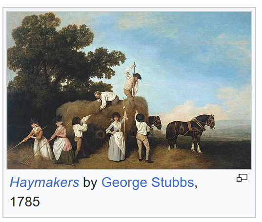</td><td></td></tr>
<tr><td colspan="2">Standard text size, and an italic link</td></tr>
<tr><td>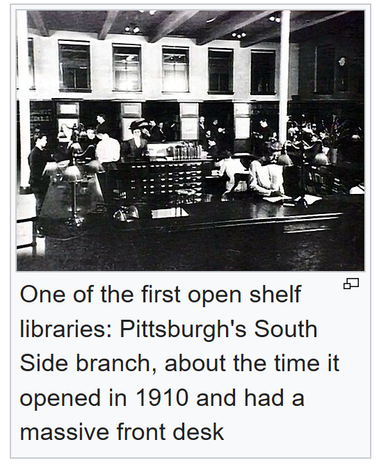</td><td>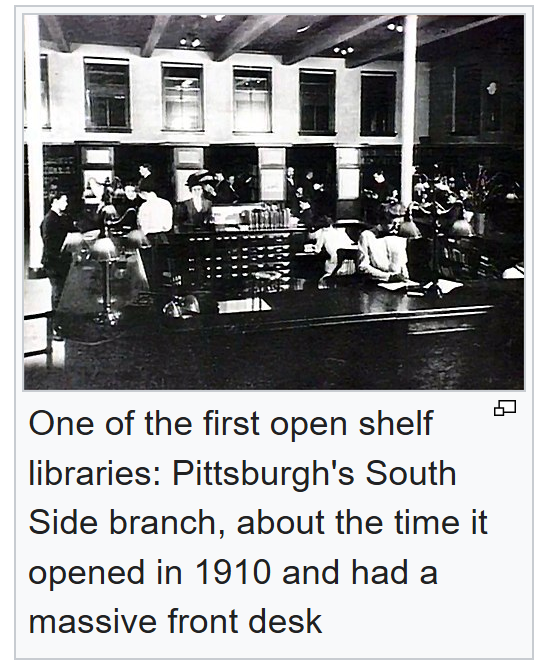</td></tr>
<tr><td colspan="2">Large text size, and a caption with three lines</td></tr>
<tr><td></td><td>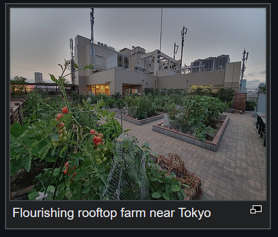</td></tr>
<tr><td colspan="2">Dark theme</td></tr>
<tr><td></td><td>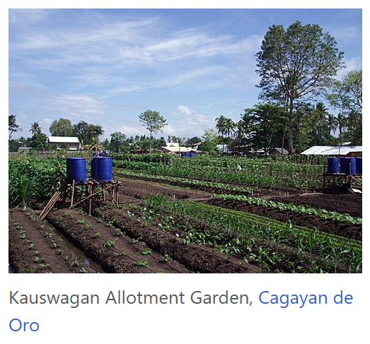</td></tr>
<tr><td colspan="2">The mobile site on a 390px phone</td></tr>
<tr><td>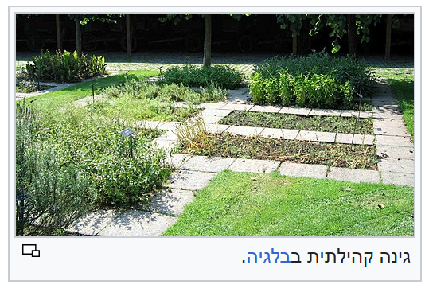</td><td></td></tr>
<tr><td colspan="2">Right-to-left, from the Hebrew Wikipedia</td></tr>
</table>

## Why this is difficult

The download must look like a real screenshot, and people who read Wikipedia often can see an error of one pixel in
the frame or in the caption.

Wikipedia does not show the original photo. Its server makes a smaller copy, makes the copy sharper and saves it as a
JPEG file. The tool does these steps in your browser, with settings that come from measurements of Wikipedia files.

Each operating system draws text in a different way. On Windows the edges of letters have colour, but on macOS,
Android and iOS they do not, so the tool draws text with the method of your computer.

Screens have different pixel densities, and a phone screen can have 3 pixels for each pixel of an old monitor. A 2x
download must be the same on all of these screens, so the download does not use the pixel density of your screen.

Browsers round half pixels in different directions, and Wikipedia shows some items, such as the enlarge icon, in an
unusual shape. Each of these details can move the result by one or two pixels.

Most of these errors are too small to see, so a script compares the tool with screenshots of Wikipedia, pixel by
pixel. Wikipedia can change at any time, and the script does this comparison again each week.

## How it works

- The preview is HTML and CSS with the dimensions of the Wikipedia thumbnail, from the Vector 2022 skin on desktop
  and from the Minerva skin on mobile.
- The export reads the layout of the preview from the browser: the box edges, the image position and the position of
  each word. Then it draws these items on a canvas.
- For a 2x or 3x download, the tool lays out a hidden copy of the preview at that pixel density. Thus the result is
  the same as a screenshot from a high-density screen.
- Wikipedia does not show the original image file. Its thumbnail server makes a 1x file and a 2x file at fixed
  widths. This tool makes the two files with the same procedure: a Lanczos3 resize, an unsharp mask, and JPEG
  encoding at quality 87. It does not make a file larger than the original.

### Accuracy

The results compare the nine pairs above with the live Wikipedia figures.

| Item | Result |
| --- | --- |
| Box size | Identical in all nine pairs |
| Frame and caption | A maximum of 0.21% of pixels are different. In five pairs, a maximum of one pixel is different. |
| Frame and caption of the preview at 1x | Identical in Chrome and Firefox |
| Photo | Small differences on fine edges. You cannot see them at normal size. |

## Notes for engineers

This section gives the technical causes of the problems in [Why this is difficult](#why-this-is-difficult).
[ENGINEERING.md](ENGINEERING.md) gives the measurements and the open problems.

### The photo

The page shows a 1x thumbnail and a 2x thumbnail in `srcset`, and does not show the original file. The quantization
tables of the Wikipedia thumbnails agree with JPEG quality 87 and 4:2:0 chroma subsampling. A grid search against
real thumbnails selected a Lanczos3 resize in sRGB, with an unsharp mask of sigma 1.0 and amount 0.7.

The thumbnail server rounds a height of x.5 down, but the `height` attribute in the page rounds it up, so with
`height: auto` this half pixel sets the height of the box. Refer to [Thumbnails](ENGINEERING.md#thumbnails).

### Text

The box uses the system `sans-serif` font, as the Vector 2022 skin does, and canvas text gets coloured sub-pixel
anti-aliasing only on an opaque canvas. A page cannot read the pixels of its own text, so at startup the tool draws a
caption on an opaque canvas with the font, size and colours of the box. If 10 or more pixels have colour channels
that differ by more than 24 levels, the default is sub-pixel text. Refer to
[Sub-pixel text](ENGINEERING.md#sub-pixel-text).

### Pixel density

The export lays out a hidden copy of the preview with CSS `zoom` equal to the download scale, because a whole-number
zoom gives the same layout at all pixel ratios. With a fractional zoom such as `scale / devicePixelRatio`, browsers
round border widths differently, and Chrome gives a 1px border a width of 1.5px at a zoom of 0.667.

Firefox rounds the `88.4%` font size of the caption after the zoom, so the copy uses the font size of the preview.
Refer to [A 2x download from a 1x screen](ENGINEERING.md#a-2x-download-from-a-1x-screen).

### Browser details

Libraries such as html2canvas use their own text layout, which is near to the layout of the browser but not the
same. Thus the export reads the position of each word from the browser and draws it on a canvas.

- The MediaWiki enlarge icon has an 11×15 drawing area, but Wikipedia shows it at 15×11.
- Chrome can show a cached 2x `srcset` file on a 1x screen if the page loaded the same URL before, so the export
  uses a private URL for each file.
- Firefox rejects `img.decode()` for an image that had a `srcset` attribute before, so the export uses a new ``.

Refer to [Export](ENGINEERING.md#export) and
[Details that each changed a pixel](ENGINEERING.md#details-that-each-changed-a-pixel).

### Checks

`tools/verify/compare.py` makes 2x screenshots of nine figures on live Wikipedia in headless Chrome, and compares
them with downloads from the tool. Each week, a workflow runs the script with `--check`. The workflow fails if one of
these occurs:

- A box has a different size.
- More than 1% of the frame and caption pixels are different.
- The photo MSE is more than 1000.

The workflow runs on Windows, because on Linux the text drawing gave differences of 3 to 5% on each figure, with the
same photos.

The browser tests in `tools/test/` run before each deploy, and a failed test stops the deploy. One test makes
downloads at different pixel ratios. It compares the pixels of downloads without a caption, but only the size of
downloads with a caption, because Linux puts text on the pixel grid of the screen. Refer to
[Run the comparisons](ENGINEERING.md#run-the-comparisons) and [Run the tests](ENGINEERING.md#run-the-tests).

## Limitations

- The photo is not bit-identical to the Wikipedia thumbnail, and the difference is largest in the 1x files of
  large photos. Refer to [Open problems](ENGINEERING.md#open-problems).
- The box uses the sans-serif font of your system, as Wikipedia does, so a download from Windows looks like a Windows
  screenshot.
- A photo of 12 megapixels or more takes approximately one second to process.

## Changes to the box

Run `python tools/verify/compare.py` before and after you change the box, and make sure that no result becomes worse.
Run `node --test tools/test/ui.test.mjs` before you push. Refer to [ENGINEERING.md](ENGINEERING.md#run-the-tests).

## Credits

The example images in `docs/` are not part of the MIT license. Each image is from Wikimedia Commons, and is in the
public domain or has the CC0 license. The captions are from the Wikipedia articles in the table, under
[CC BY-SA 4.0](https://creativecommons.org/licenses/by-sa/4.0/).

| Image | Author | License | Article |
| --- | --- | --- | --- |
| [Old-fashioned well in Finland](https://commons.wikimedia.org/wiki/File:Old-fashioned_well_in_Finland.JPG) | SeppVei | Public domain | [Well](https://en.wikipedia.org/wiki/Well) |
| [Barn raising, DeKalb County](https://commons.wikimedia.org/wiki/File:Barn_Raising_DeKalb_County_IN.jpg) | J.E. Curtis | Public domain | [Barn raising](https://en.wikipedia.org/wiki/Barn_raising) |
| [Point Danger lighthouse](https://commons.wikimedia.org/wiki/File:Point_Danger_lighthouse.jpg) | Eertman at Dutch Wikipedia | Public domain | [Lighthouse](https://en.wikipedia.org/wiki/Lighthouse) |
| [Cornell box, with and without radiosity](https://commons.wikimedia.org/wiki/File:BMRT_-_Cornell_box,_with_and_without_radiosity.gif) | Morn | CC0 | [Radiosity (computer graphics)](https://en.wikipedia.org/wiki/Radiosity_(computer_graphics)) |
| [Haymaking](https://commons.wikimedia.org/wiki/File:George_Stubbs_-_Haymaking_-_WGA21948.jpg) | George Stubbs | Public domain | [Hay](https://en.wikipedia.org/wiki/Hay) |
| [Carnegie Library, South Side branch](https://commons.wikimedia.org/wiki/File:Carnegie_Library_Pittsburgh_SSide_branch_early_days.jpg) | Unknown | Public domain | [Carnegie library](https://en.wikipedia.org/wiki/Carnegie_library) |
| [Farm above Atré Ebisu](https://commons.wikimedia.org/wiki/File:Farm_above_Atr%C3%A9_Ebisu.jpg) | Syced | CC0 | [Community gardening](https://en.wikipedia.org/wiki/Community_gardening) |
| [Kauswagan Allotment Garden](https://commons.wikimedia.org/wiki/File:Kauswagan_Allotment_Garden.JPG) | Rjholmer at English Wikipedia | Public domain | [Allotment (gardening)](https://en.wikipedia.org/wiki/Allotment_(gardening)) |
| [Herbal patch, Lippensgoed-Bulskampveld](https://commons.wikimedia.org/wiki/File:HerbalPatch_Lippensgoed_Bulskampveld.jpg) | KVDP | Public domain | [גינה קהילתית](https://he.wikipedia.org/wiki/גינה_קהילתית) (Hebrew Wikipedia) |

## License

MIT. Refer to [LICENSE](../LICENSE).

This project is not related to the Wikimedia Foundation. Wikipedia is a trademark of the Wikimedia Foundation.
